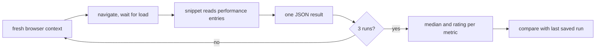

<div align="center">


# page-load-metrics

Measure how fast a page loads, three cold loads at a time, and see what changed since last time.

[한국어](README.ko.md) · Node 22+ · Chrome · zero dependencies

[](https://github.com/elfenomenokim/page-load-metrics/actions/workflows/tests.yml)
[](https://www.npmjs.com/package/page-load-metrics)
[](LICENSE)

[Install](#install) · [Quick start](#quick-start) · [Signed-in pages](#signed-in-pages) · [Reference](#reference) · [Limits](#limits)

</div>

```console
$ npx page-load-metrics https://example.com
https://example.com  ·  median of 3 cold loads  ·  1350x940

metric              median  rating  change          runs
------------------  ------  ------  --------------  ----
ttfb                117 ms  good    -8 ms (-6%)     3/3
fcp                 188 ms  good    -52 ms (-22%)   3/3
lcp                 236 ms  good    -116 ms (-33%)  3/3
cls                 0       good    0               3/3
blocking            0 ms    good    0 ms            3/3
dom_content_loaded  163 ms          -11 ms (-6%)    3/3
load                164 ms          -11 ms (-6%)    3/3
transfer            1.6 kB          0 kB (0%)       3/3
requests            1               0 (0%)          3/3

LCP element: p "Данный домен предназначен для "
change: against 2026-11-21T03:55:58.056Z
```

<sub>A real run from a Mac mini on 2026-11-21, the second of two; `change` compares it with the first. example.com served this machine its Russian text, which is why the LCP paragraph is in Russian.</sub>

## Why

You changed a page and want to know if it got slower. Lighthouse answers with a full audit
and a score; [web-vitals](https://github.com/GoogleChrome/web-vitals) answers from real users
once you ship it in your page. page-load-metrics answers the narrow question in seconds:

- **Cold every time.** Each run uses a fresh browser context, so no cache, cookies or service
  worker carry over. The median of three runs hides one noisy load.
- **Change since last run.** Every result is saved per URL and viewport; the next run shows the
  difference. Run it before and after a deploy.
- **Unknown stays unknown.** If the browser cannot report a metric, it is `n/a`, never a
  reassuring zero.
- **Why it is slow, not just a score.** The LCP element with its load/render split, the nodes
  that shifted, the scripts that blocked the main thread, and the heaviest files.
- **Works where a CLI cannot go.** The measuring code is one browser snippet. Paste it into any
  session that can run JavaScript, including a signed-in one, and summarize the results.

| | page-load-metrics | Lighthouse | web-vitals |
|---|---|---|---|
| Question | did this page get slower? | how good is this page overall? | how fast is it for real users? |
| Runs | 3 cold loads, median | 1 audited load | every real visit |
| Compares with last run | yes | no (manual) | through your analytics |
| Needs your page's code | no | no | yes |
| Slow phone and network | `--throttle` (Lighthouse mobile preset) | yes | real devices |

## Install

```sh
npx page-load-metrics https://example.com      # or: npm install -g page-load-metrics
```

Needs Node 22 or newer and Google Chrome or Chromium. The CLI finds Chrome in the usual places
on macOS and Linux; otherwise pass `--chrome PATH` or set `CHROME_PATH`.

## Quick start

```sh
page-load-metrics https://example.com              # 3 cold loads at 1350x940
page-load-metrics https://example.com --mobile     # 412x915, mobile user agent
page-load-metrics https://example.com --mobile --throttle   # slow 4G and 4x CPU, like a mid-range phone
page-load-metrics https://example.com --runs 5     # more runs, steadier median
page-load-metrics https://example.com --json       # summary, previous run and every raw result
```

History lives in `~/.local/state/page-load-metrics/history.jsonl`. Use `--store DIR` to keep
one per project, or `--no-save` for a one-off.

## Signed-in pages

The CLI opens a fresh browser with no sign-in. For a page behind a login, run the snippet in
your own session and let the CLI summarize:

1. Open the page in a browser where you are signed in and hard-reload it.
2. Run `page_load_metrics.js` in the DevTools console (or through your automation tool's
   evaluate command). It returns one JSON object. Save it to a file.
3. Repeat twice more, then:

```sh
page-load-metrics summarize run1.json run2.json run3.json
```

`summarize` prints the same table and saves to the same history.

## How it works



The CLI starts headless Chrome with a throwaway profile and speaks the DevTools Protocol over
Node's built-in WebSocket. The snippet waits for `load`, then 2 seconds for late paints and
shifts, and reads the browser's own performance entries.

## Reference

```
page-load-metrics URL [--runs 3] [--mobile | --viewport WxH] [--throttle] [--cpu N] [--settle 2000]
                      [--json] [--no-save] [--store DIR] [--chrome PATH] [--timeout 60000]
page-load-metrics summarize FILE... [--json] [--no-save] [--store DIR]
```

| Metric | What it is | good / needs improvement / poor |
|---|---|---|
| `ttfb` | Time to first byte of the document | ≤ 800 / ≤ 1800 / more (ms) |
| `fcp` | First contentful paint | ≤ 1800 / ≤ 3000 / more (ms) |
| `lcp` | Largest contentful paint, with its element | ≤ 2500 / ≤ 4000 / more (ms) |
| `cls` | Cumulative layout shift (largest session window) | ≤ 0.1 / ≤ 0.25 / more |
| `blocking` | Main-thread blocking after FCP, approximates total blocking time | ≤ 200 / ≤ 600 / more (ms) |
| `dom_content_loaded`, `load` | Navigation timing endpoints | not rated |
| `transfer`, `requests` | Bytes over the network and resource count | not rated |

The bands follow web.dev and Lighthouse lab thresholds. `runs` shows how many runs reported the
metric. The snippet result (`--json` → `results`) also carries the LCP load/render split, the
top layout shifts with their nodes, the top blocking scripts, render-blocking files and the
eight heaviest resources.

## Limits

- Without `--throttle`, numbers from a fast machine on a fast line are optimistic. `--throttle`
  applies Lighthouse's mobile preset through the DevTools Protocol: 562.5 ms request latency,
  1474.56 Kbps down, 675 Kbps up and 4x CPU slowdown (`--cpu N` changes the factor). CPU slowdown
  is relative to the machine you run on, so compare runs from the same machine. History keeps
  throttled and unthrottled runs apart.
- One page load, not interactions. INP needs real input and is not measured.
- It reads the page it runs in. Cross-origin frames and workers are not included.
- `blocking` uses long animation frames where Chrome supports them, else long tasks; where the
  browser supports neither it is `n/a`.
- The 2-second settle after `load` can miss shifts on pages that keep moving later.

## Contributing

Issues and pull requests are welcome. See [CONTRIBUTING.md](CONTRIBUTING.md).

## License

[MIT](LICENSE)
